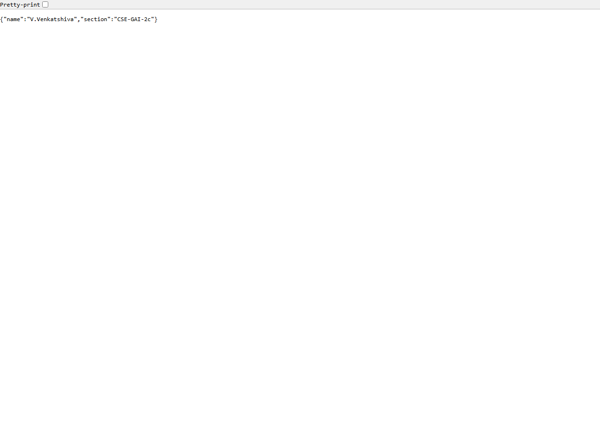
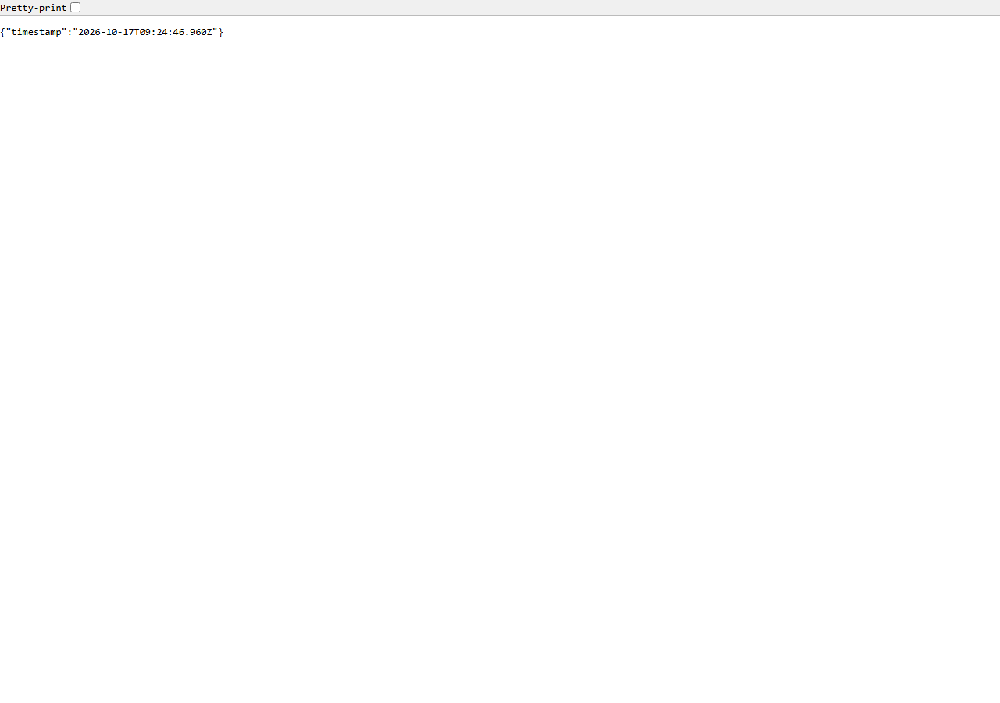
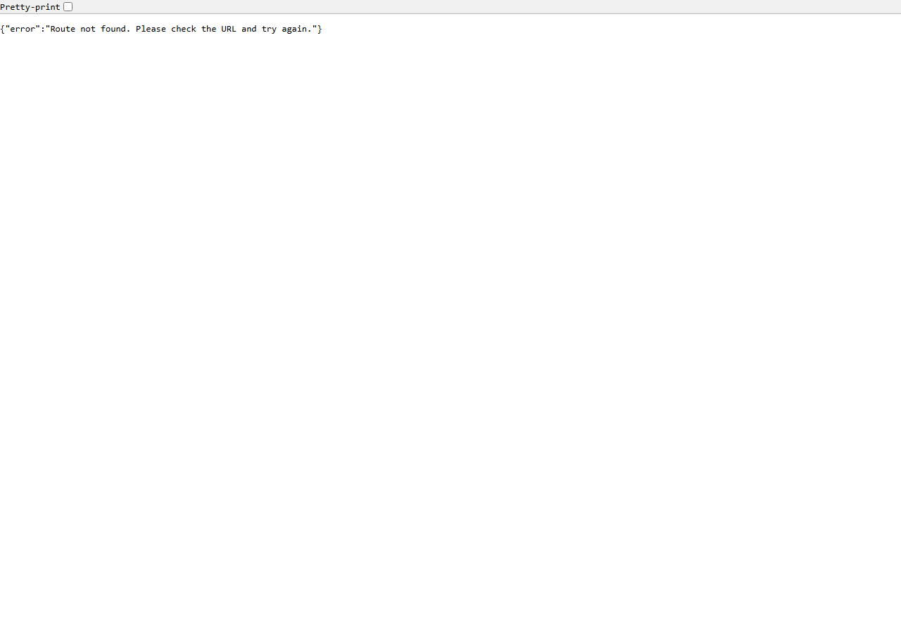

# Backend Development Fundamentals Lab 1

## Lab Overview
This project is a simple backend application built with Node.js and Express.js for the Backend Development Fundamentals Lab 1 assignment. It demonstrates the native Node.js HTTP server and the Express.js framework for web endpoints.

## Student Details
- Student name: V.Venkatshiva
- Section: CSE-GAI-2c
- Academic year: 2nd-year B.Tech
- Operating system: Windows
- Code editor: VS Code

## University and Faculty
- University: [Add your university name here]
- Faculty: [Add your faculty name here]

## Project Objective
The objective of this lab is to learn how to:
- create a basic HTTP server with the native Node.js `http` module,
- build an Express.js application with routes,
- test endpoint responses,
- document the project clearly, and
- prepare the project for future deployment.

## Technologies Used
- Node.js
- Express.js
- JavaScript
- HTTP protocol basics
- Git and GitHub

## Project Folder Structure
```text
Backend-Development-Fundamentals-Lab-1/
├── app.js
├── server.js
├── package.json
├── package-lock.json
├── .gitignore
├── README.md
├── tests/
│   └── app.test.js
└── screenshots/
    ├── home.png
    ├── about.png
    ├── time.png
    └── not-found.png
```

## Installation
1. Install Node.js from the official website: https://nodejs.org/en/download
2. Verify the installation:
   ```bash
   node -v
   npm -v
   git --version
   ```
3. Open the project folder in VS Code.
4. Install dependencies:
   ```bash
   npm install
   ```

## Run the Native HTTP Server
To start the Node.js native HTTP server:
```bash
node server.js
```
The server listens on port 3000 and prints a startup message.

## Run the Express Application
To start the Express application:
```bash
npm start
```
The app uses `process.env.PORT || 3000` and listens on the configured port.

## API Endpoints
| Route | Method | Expected Status | Description |
| --- | --- | --- | --- |
| `/` | GET | 200 | Welcome message |
| `/about` | GET | 200 | Returns full name and section |
| `/time` | GET | 200 | Returns current timestamp |
| Any unknown route | GET | 404 | Not found message |

### Example Responses

#### GET `/`
```text
Welcome to Backend Development Fundamentals Lab 1!
```

#### GET `/about`
```json
{
  "name": "V.Venkatshiva",
  "section": "CSE-GAI-2c"
}
```

#### GET `/time`
```json
{
  "timestamp": "2026-10-17T12:34:56.789Z"
}
```

#### GET `/unknown`
```json
{
  "error": "Route not found. Please check the URL and try again."
}
```

## Screenshots
The screenshots for the routes are stored in the `screenshots` folder and should match the following paths:








> Capture the screenshots using a real browser locally in VS Code or using Windows Snipping Tool if needed. This project does not include fake or placeholder image content.

## Common Errors and Solutions
- `EADDRINUSE`: Another service is already using port 3000. Stop the active process or use a different port.
- `Cannot GET /...`: Check the route spelling and ensure the route is registered before the 404 middleware.
- `module not found`: Run `npm install` to install missing dependencies.
- `PORT` issues: Set `PORT` in the environment or rely on the default `3000` value.

## Problems Faced and Solutions
- The project started without a Git repository, so Git was initialized carefully.
- The native HTTP server and Express app both use the same default port, so testing was done with separate ports when necessary to avoid conflicts.
- The 404 route needed to be registered after all valid routes to work correctly.

## Learning Outcomes
- Learned how to create a Node.js HTTP server using the built-in `http` module.
- Learned how Express.js routes work with `app.get()` and `res.json()`.
- Learned how to handle JSON responses and 404 errors.
- Learned how to create a simple backend project workflow using Git, npm, and README documentation.

## GitHub Repository
- GitHub: https://github.com/venkatshiva7032/Backend-Development-Fundamentals-Lab-1

## Git Hygiene and .gitignore
This project includes a `.gitignore` file to prevent committing the following:
- `node_modules/`
- `.env`
- `.env.*`
- editor and system files

This prevents credentials, environment configuration, and large dependency folders from being accidentally published to GitHub.

## Future Deployment on Render
This project is prepared for future deployment on Render. The planned steps are:
1. Connect the GitHub repository to Render.
2. Create a Web Service.
3. Select the Node.js runtime.
4. Set the build command to `npm install`.
5. Set the start command to `npm start`.
6. Deploy and inspect the logs.
7. Test the public endpoints.

This application uses `process.env.PORT || 3000`, so Render will provide the correct port automatically in production.

> Deployment has not been performed yet. The actual Render URL will be added only after deployment and testing are completed by the student.

## Git Commands for Submission
```bash
git init
git add .
git commit -m "Complete Backend Development Fundamentals Lab 1"
git branch -M main
git remote add origin https://github.com/venkatshiva7032/Backend-Development-Fundamentals-Lab-1.git
git push -u origin main
```

> Use the exact repository URL from the assignment. Do not force-push or overwrite existing history.

